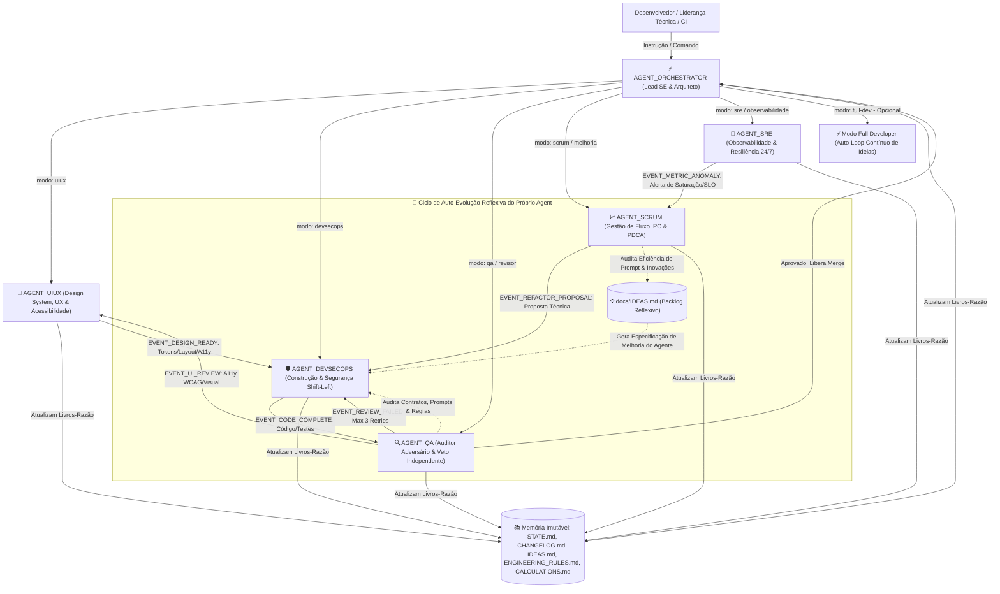

# 🏗️ ARQUITETURA MULTI-AGENTE & GOVERNANÇA UNIVERSAL

> **Visão Geral:** Este documento detalha a topologia de cooperação, barramento de eventos lógicos, handovers determinísticos, limites de retry e os loops autônomos que regem a suíte de 6 agentes especialistas do **.agents-hub**.

---

## 1. Topologia da Rede Multi-Agente & Auto-Evolução Reflexiva

A suíte opera sob uma arquitetura hierárquica e cooperativa (Mesh-Hierarchical), onde o **AGENT_ORCHESTRATOR** atua como coordenador e despachante central, orquestrando cinco agentes operacionais especializados (UI/UX, DevSecOps, QA, Scrum e SRE), totalizando 6 agentes canônicos:



---

## 2. Como os Agentes Conversam e Acionam Uns aos Outros

A comunicação e transição entre agentes é regida por **Gatilhos de Handover (Passagem de Bastão)** determinísticos:

### 2.1. Handover AGENT_ORCHESTRATOR / SCRUM ➡️ AGENT_UIUX (Gatilho: `EVENT_REQUIREMENTS_READY`)
* **Momento:** Assim que os Requisitos Funcionais ou a História de Usuário de uma interface visual são formalizados.
* **Ação Automática:** O Orchestrator despacha o escopo para o **AGENT_UIUX**, que define a arquitetura de informação, fluxos de usuário, design tokens e especificações de acessibilidade (WCAG 2.1 AA).

### 2.2. Handover AGENT_UIUX ➡️ AGENT_DEVSECOPS (Gatilho: `EVENT_DESIGN_READY`)
* **Momento:** Concluída a especificação de interface, design tokens e estados dos componentes (default, hover, focus, loading, error).
* **Ação Automática:** O DevSecOps recebe o guia de implementação semântica HTML/CSS/Tailwind e inicia a codificação cirúrgica, sem ambiguidade visual.

### 2.3. Handover AGENT_DEVSECOPS ➡️ AGENT_QA (Gatilho: `EVENT_CODE_COMPLETE`)
* **Momento:** Assim que o Agente DevSecOps conclui a escrita de código, criação de testes locais e validação de segurança.
* **Ação Automática:** O DevSecOps não aprova a própria entrega. Ele aciona o **AGENT_QA**, passando o diff gerado e o contexto do ticket.
* **Comportamento do Revisor:** Assume postura de auditor cego e adversário, caçando ativamente vulnerabilidades, casos de borda não testados, problemas de concorrência ou quebras das 14 Regras.

### 2.4. Handover AGENT_QA ➡️ AGENT_DEVSECOPS (Gatilho: `EVENT_REVIEW_FAILED`)
* **Momento:** O Revisor encontra qualquer falha (teste que quebra, vulnerabilidade CWE, ausência de tratamento de erro ou regressão).
* **Ação Automática:** O Revisor emite um parecer técnico estrito, escreve um teste unitário negativo que reproduz o problema e devolve a responsabilidade para o Agente DevSecOps corrigir antes de qualquer aprovação.
* **Teto Estrito de 3 Tentativas:** Limite máximo de 3 retries consecutivos. Persistindo a falha, o Orchestrator suspende a execução para mediação humana.

### 2.5. Handover AGENT_QA ➡️ AGENT_UIUX (Gatilho: `EVENT_UI_REVIEW`)
* **Momento:** Em entregas com interface gráfica, o QA executa varreduras automatizadas de acessibilidade (axe-core, contrast ratio, navegação por teclado sem focus trap). Se houver quebra de acessibilidade ou desalinhamento com o Design System, o UI/UX é notificado para reajustar tokens ou layouts.

### 2.6. Handover AGENT_SRE ➡️ AGENT_SCRUM (Gatilho: `EVENT_METRIC_ANOMALY`)
* **Momento:** O Agente de Observabilidade detecta quebra de SLO, aumento de latência média (p95/p99), vazamento de memória ou degradação de Core Web Vitals (LCP/INP/CLS).
* **Ação Automática:** Executa o playbook imediato de auto-remediação segura e despacha um alerta com métricas numéricas para o **AGENT_SCRUM**.

### 2.7. Handover AGENT_SCRUM ➡️ AGENT_DEVSECOPS (Gatilho: `EVENT_REFACTOR_PROPOSAL`)
* **Momento:** O Scrum formula uma proposta validada de redução de débito técnico após investigação Ishikawa (6M).
* **Ação Automática:** Cadastra a tarefa no backlog e solicita ao DevSecOps a abertura de uma branch dedicada para a refatoração.

---

## 3. Os 8 Loops Autônomos de Governança

Cada agente opera dentro de um ou mais loops contínuos:

```text
1. LOOP SEGURANÇA (DevSecOps + QA):
   → detectar (SAST / SCA / CodeQL / TruffleHog)
   → priorizar (Matriz de Severidade CVSS/CWE)
   → corrigir na raiz (sanitização recursiva, sem ReDoS)
   → validar com testes de invasão negativos
   → documentar e atualizar ledgers

2. LOOP QUALIDADE (Scrum + QA):
   → medir complexidade e cobertura de testes
   → identificar duplicações e code smells
   → refatorar mantendo compatibilidade
   → testar regressões e mutação
   → registrar ganhos em CALCULATIONS.md

3. LOOP ARQUITETURA (Orchestrator Lead SE):
   → modelar requisitos funcionais e não funcionais (ISO/IEC 25010)
   → avaliar trade-offs técnicos (Opção A vs B vs Status Quo)
   → modularizar e desacoplar contratos (OpenAPI/gRPC)
   → redigir ADR (Architecture Decision Record Nygard)
   → sincronizar com a documentação corporativa

4. LOOP EXPERIÊNCIA DO USUÁRIO & DESIGN SYSTEM (UIUX + QA + DevSecOps):
   → auditar 10 Heurísticas de Usabilidade de Nielsen e Leis de UX
   → assegurar conformidade com W3C WCAG 2.1 AA (contraste 4.5:1, navegação por teclado)
   → padronizar escala modular de 8px e estados de componentes (7 estados)
   → otimizar Core Web Vitals (LCP < 2.5s, INP < 200ms, CLS < 0.1)

5. LOOP DEVOPS & CI/CD (SRE + DevSecOps):
   → executar esteiras padronizadas em 5 estágios (Lint -> Test -> Security -> Package -> Deploy)
   → monitorar probes de saúde (/health e /ready)
   → automatizar verificações pré-commit e pré-push
   → aplicar auto-remediação de infraestrutura

6. LOOP PRODUTIVIDADE & FLUXO (Agile Coach Scrum + Orchestrator):
   → gerenciar métricas de fluxo (Lead Time, Cycle Time, WIP Limits, Throughput)
   → investigar causa-raiz via Ishikawa (6M) e 5 Porquês
   → garantir Tríplice Registro contínuo (Git, Jira e Confluence)
   → erradicar retrabalho e desperdício (Lean)

7. LOOP AUTO-EVOLUÇÃO REFLEXIVA (Suíte Completa de 6 Agentes):
   → auto-avaliar clareza de prompts e consumo de tokens
   → testar portabilidade cruzada entre LLMs
   → gerar novas ideias de ferramentas em docs/IDEAS.md
   → auditar e refinar os próprios contratos operacionais

8. LOOP FULL DEVELOPER (Modo Opcional nos 3 Kanbans Canônicos - A fazer, Em andamento, Concluído):
   → inspecionar tarefas pendentes na coluna canônica "A fazer" (via scripts/jira_kanban_standardizer.js)
   → aplicar análise profunda de pertinência (Regra 14 - Ideation Sanity Filter)
   → transicionar card aprovado para "Em andamento" antes de tocar no código
   → codificar em branch dedicada com testes e arquitetura limpa (AGENT_DEVSECOPS)
   → submeter a auditoria cega adversária e aprovação (AGENT_QA)
   → validar esteira CI/CD (100% checks verdes) e merge na main
   → transicionar card para "Concluído" com relatório denso de 15 seções e ADR
   → encadear automaticamente para a próxima tarefa em "A fazer" em loop recursivo contínuo
```

---

## 4. O Sistema de Memória Imutável

A suíte não depende de memória volátil da sessão. Toda a continuidade operacional é ancorada nos arquivos da pasta `/docs`:
* `STATE.md`: Quadro vivo de execução (Meta ativa, Sprint, Done, Next, Blockers).
* `CHANGELOG.md`: Livro-razão histórico imutável (estritamente append-only).
* `ENGINEERING_RULES.md`: Contrato normativo de regras inegociáveis.
* `IDEAS.md`: Backlog vivo de inovações da aplicação e de auto-evolução dos agentes.
* `CALCULATIONS.md`: Livro-razão de dimensionamento numérico, benchmarks e telemetria.
