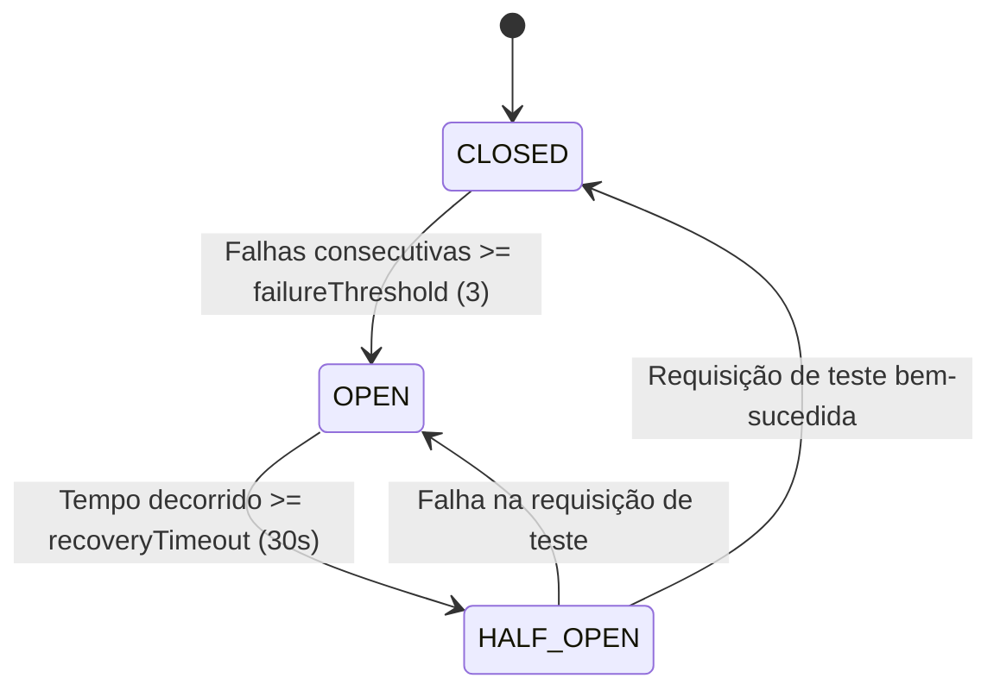

# ⚡ PLAYBOOK DE SRE: CIRCUIT BREAKER INTELIGENTE MULTI-PROVEDOR PARA LLMS

---
playbook: sre-circuit-breaker-llm
versao: 1.0.0
proprietario: Agente SRE & Observabilidade (AGENT_SRE.md)
referencia: AGDEV-9 (I-10) / Padrão de Engenharia de Resiliência Michael Nygard
---

## 🎯 1. OBJETIVO & ESCOPO
Este playbook estabelece a estratégia de continuidade de negócio e tolerância a falhas para agentes de inteligência artificial diante de instabilidades de provedores de LLM externos (erros HTTP 429 - Rate Limit, 503 - Service Unavailable, 504 - Gateway Timeout ou latência excessiva).

---

## 🔄 2. MÁQUINA DE ESTADOS DO CIRCUIT BREAKER
Cada provedor de IA possui seu próprio disjuntor com 3 estados canônicos:

1. **CLOSED (Fechado)**: Tráfego normal direcionado ao provedor primário. Falhas incrementam o contador.
2. **OPEN (Aberto)**: Circuito rompido. Chamadas são abortadas imediatamente sem bater na API externa, acionando o próximo provedor na cadeia de fallback.
3. **HALF_OPEN (Meio-Aberto)**: Após 30 segundos de cooldown, uma chamada de teste é autorizada. Se responder com sucesso, o circuito retorna para CLOSED; se falhar, retorna para OPEN.

---

## ⛓️ 3. CADEIA CANÔNICA DE FALLBACK MULTI-PROVEDOR
A ordem de comutação automática respeita a relação de capacidade, latência e custo:

1. **Primário (Fronteira Analítica)**: Anthropic (`claude-3-5-sonnet`) / OpenAI (`gpt-4o`)
   - Em caso de HTTP 429 ou 5xx após 3 tentativas:
2. **Secundário (Alta Velocidade / Fallback de Fronteira)**: Groq (`llama-3.3-70b-versatile` / `deepseek-r1-distill-llama-70b`)
   - Em caso de falha de conexão:
3. **Terciário (Resiliência Local / Offline)**: Ollama (`qwen2.5-coder:7b` / `llama3.1:8b`)
   - Execução local em hardware do desenvolvedor com o prompt compactado (`AGENT_ORCHESTRATOR_COMPACTO.md`).

---

## 📊 4. OBSERVABILIDADE & ALERTAS PROMETHEUS
O módulo expõe as seguintes métricas canônicas:
- `llm_circuit_breaker_state{provider="anthropic"}`: 0=CLOSED, 1=OPEN, 2=HALF_OPEN
- `llm_circuit_breaker_fallbacks_total{from="anthropic",to="groq"}`: contador acumulado de chaveamentos
- `llm_provider_latency_seconds{provider="groq"}`: histograma de latência

### Alerta SRE: `LLMAllCircuitsOpen`
Se todos os provedores da cadeia estiverem com circuito `OPEN`, o agente emite notificação de severidade CRÍTICA no Jira e ativa o modo local estrito.
